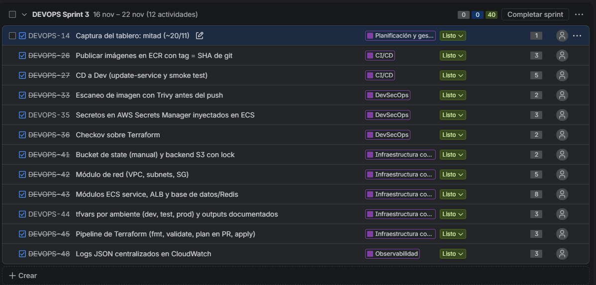

# Evidencias del Sprint 3 (16/11 al 22/11/2026)

## Tablero (DEVOPS-14)

Captura tomada **al cierre del sprint (22/11/2026)**, con las 12 tareas en *Listo*
(40 story points). La captura de mitad de sprint (~20/11) que pedía la tarea
**no se tomó**; se deja constancia en lugar de reconstruirla.

## Otras evidencias

| Tarea | Archivo |
|---|---|
| DEVOPS-26 Imágenes en ECR y tienda en dev | `DEVOPS-26-ecr-repositorios.png`, `DEVOPS-26-ecs-servicios-dev.png`, `DEVOPS-26-tienda-compra-dev.png` |
| DEVOPS-27 CD a dev | `DEVOPS-27-deploy-dev.png` |
| DEVOPS-48 Logs JSON y Logs Insights | `DEVOPS-48-consultas-logs.png` (detalle en [logs-json.md](../../observabilidad/logs-json.md#evidencia)) |

Las evidencias de infraestructura (41, 42, 43) están en `docs/evidencias/sprint3/` de tero-infra.
