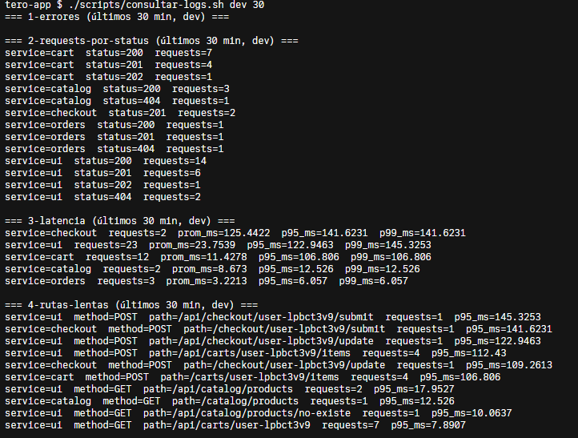

# Logs en JSON y consultas en CloudWatch Logs Insights (DEVOPS-48)

## Por qué JSON

Antes cada servicio escribía logs de texto con un formato distinto (gin en Go,
uvicorn en Python, Nest y `console.log` en Node). Para buscar "todos los errores
de los últimos 15 minutos" había que leer línea por línea.

Ahora **los 6 servicios escriben una línea JSON por evento con los mismos
campos**. CloudWatch Logs Insights detecta el JSON solo y cada campo se puede
filtrar, agrupar y graficar sin parsear nada.

## Formato

Una línea por request HTTP (`msg = "request"`):

```json
{"time":"2026-11-23T00:47:24.872Z","level":"WARN","msg":"request","service":"ui","method":"GET","path":"/nope.css","status":404,"duration_ms":1.27}
```

| Campo | Qué es |
|---|---|
| `time` | Momento del evento, ISO 8601 en UTC |
| `level` | `INFO`, `WARN` (status 4xx) o `ERROR` (status 5xx o error de la app) |
| `msg` | `request` para las requests; otro texto para eventos de la app (arranque, errores) |
| `service` | `catalog`, `cart`, `orders`, `checkout`, `ui` o `admin` |
| `method`, `path`, `status` | Request HTTP. `path` **sin query string** (puede traer datos del usuario) |
| `duration_ms` | Tiempo de respuesta en milisegundos |
| `error` | (solo Python) stack trace de una excepción |

Decisiones:

- **`/health` no se loguea**: el ALB lo llama cada pocos segundos por tarea y
  llenaría los logs de ruido (y de costo). Si el health check falla, se ve en el
  target group y en los eventos del servicio ECS.
- **No se loguean bodies, headers ni cookies**: pueden tener datos personales
  (dirección, email en el checkout) o el JWT del admin.
- **stdout**: el contenedor escribe a stdout y el driver `awslogs` de ECS lo
  manda al log group `/tero/<ambiente>/<servicio>` (Terraform, DEVOPS-43), con
  la retención definida en DEVOPS-47.

### Implementación por servicio

| Servicio | Lenguaje | Cómo |
|---|---|---|
| catalog, orders | Go (gin) | `log/slog` con `JSONHandler` como logger por defecto (así `log.Fatal` también sale en JSON) + middleware `JSONLogger` en lugar del logger de texto de gin (`jsonlog.go`) |
| cart | Python (FastAPI) | `logging` con `JsonFormatter`, middleware HTTP y access log de uvicorn deshabilitado (`app/jsonlog.py`) |
| ui, admin | Node (Express) | middleware `requestLogger` (`src/jsonlog.ts`) |
| checkout | Node (NestJS) | mismo `jsonlog.ts` desde `LoggerMiddleware`; los logs propios de Nest con `ConsoleLogger({ json: true })` |

El logger se repite en cada servicio a propósito (cada uno se construye por
separado y en lenguajes distintos), por eso está excluido de la detección de
duplicados de SonarCloud (`sonar.cpd.exclusions`). Tiene tests en Go y Python.

> Nest escribe sus propios eventos (arranque, excepciones no manejadas) con su
> formato JSON: `{"level":"error","context":"...","message":"..."}`. Las
> consultas de errores de abajo contemplan los dos (`level` en mayúscula o
> minúscula).

## Consultas de Logs Insights

En la consola: **CloudWatch → Logs Insights**, elegir los log groups
`/tero/dev/*` (los 6) y el rango de tiempo. También se pueden correr desde
CloudShell con [`scripts/consultar-logs.sh`](../../scripts/consultar-logs.sh).

### 1. Errores recientes (5xx y errores de la app)

```
fields @timestamp, service, level, method, path, status, msg, message
| filter level in ["ERROR", "error"]
| sort @timestamp desc
| limit 50
```

Trae solo nivel `ERROR`: los 5xx (falla del servidor) y los errores que loguea
la app. Los 4xx **no** aparecen acá: son errores del cliente (una ruta que no
existe, un dato mal mandado) y se loguean como `WARN`. Para verlos:
la consulta 2 (agrupa por `status`) o `filter level = "WARN"`.

### 2. Volumen de requests por servicio y status

```
filter msg = "request"
| stats count(*) as requests by service, status
| sort service, status
```

### 3. Latencia por servicio (promedio, p95, p99)

```
filter msg = "request"
| stats count(*) as requests, avg(duration_ms) as prom_ms,
        pct(duration_ms, 95) as p95_ms, pct(duration_ms, 99) as p99_ms by service
| sort p95_ms desc
```

### 4. Rutas más lentas

```
filter msg = "request"
| stats count(*) as requests, pct(duration_ms, 95) as p95_ms by service, method, path
| sort p95_ms desc
| limit 10
```

### 5. Errores 5xx en el tiempo (cada 5 minutos)

```
filter msg = "request" and status >= 500
| stats count(*) as errores_5xx by bin(5m), service
```

Con la pestaña *Visualization* queda un gráfico de líneas por servicio: sirve
para ver si los errores empezaron con un deploy (comparar con la hora del job
`deploy-dev`).

### 6. Seguir una compra de punta a punta

```
filter msg = "request" and path like /checkout|orders|carts/
| fields @timestamp, service, method, path, status, duration_ms
| sort @timestamp asc
```

Muestra en orden la secuencia ui → carts → checkout → orders de una compra.

## Evidencia



`./scripts/consultar-logs.sh dev 30` en CloudShell (22/11/2026), después de
usar la tienda (navegar, carrito, compra) y forzar dos 404 con `curl`:

- **1-errores vacía:** no hubo ningún 5xx ni error de la app. Los 404 forzados
  no aparecen porque son `WARN` (ver la consulta 1).
- **2-requests-por-status:** cada servicio con sus status, incluidos los
  `status=404` de catalog, orders y ui.
- **3-latencia:** checkout es el más lento (~125 ms promedio, llama a orders y
  a Redis); catalog y orders responden en menos de 10 ms.
- **4-rutas-lentas:** las más lentas son el `submit` y el `update` del checkout
  y agregar al carrito; aparece la ruta forzada `/api/catalog/products/no-existe`.
  El path se guarda sin query string, así que no se filtran parámetros.

Las consultas 5 y 6 se corren en la consola de Logs Insights.
